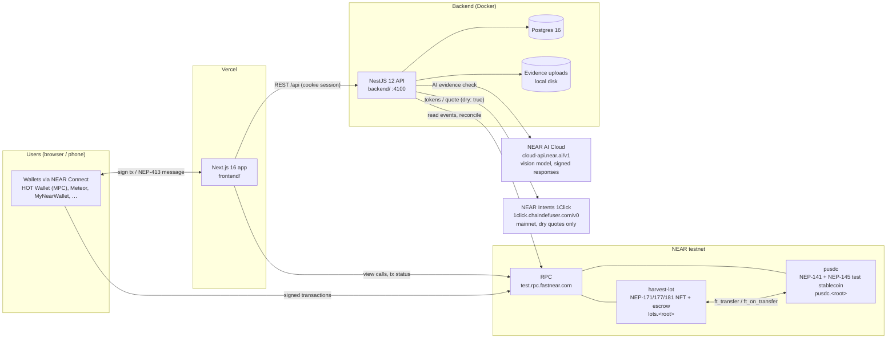
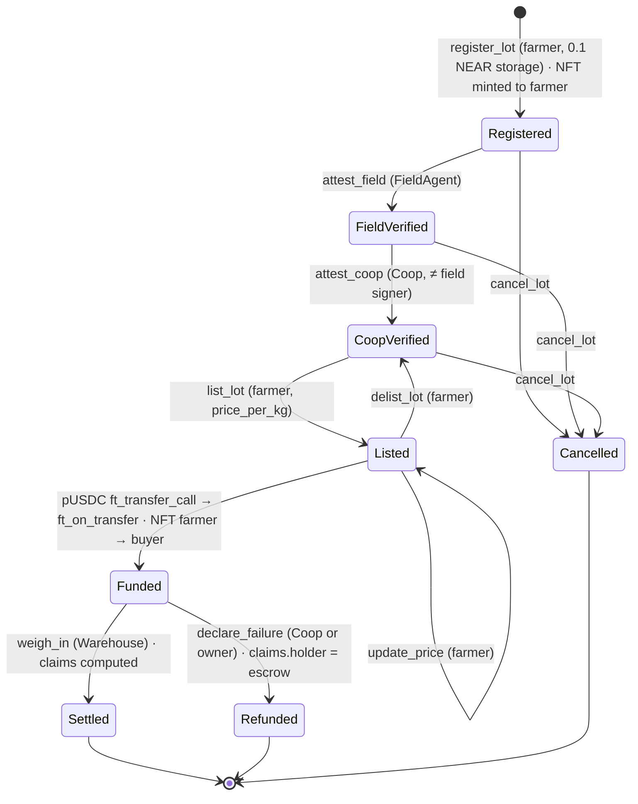
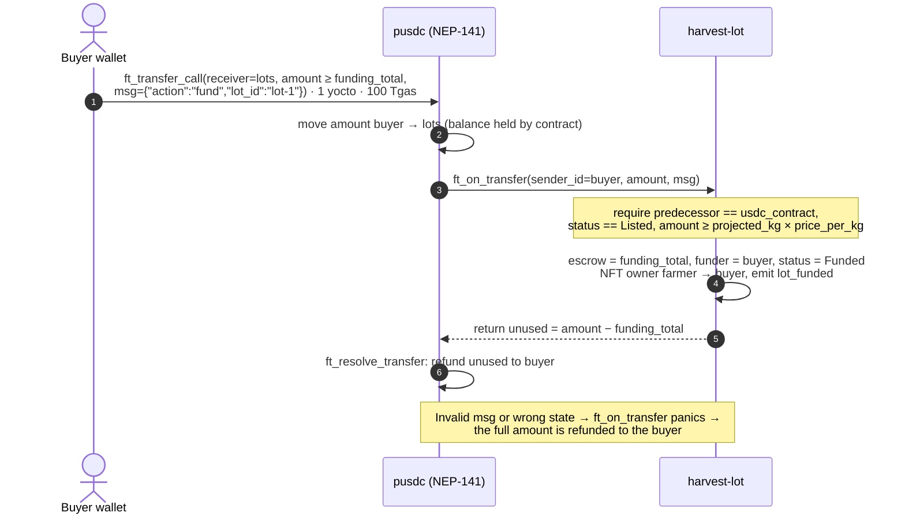
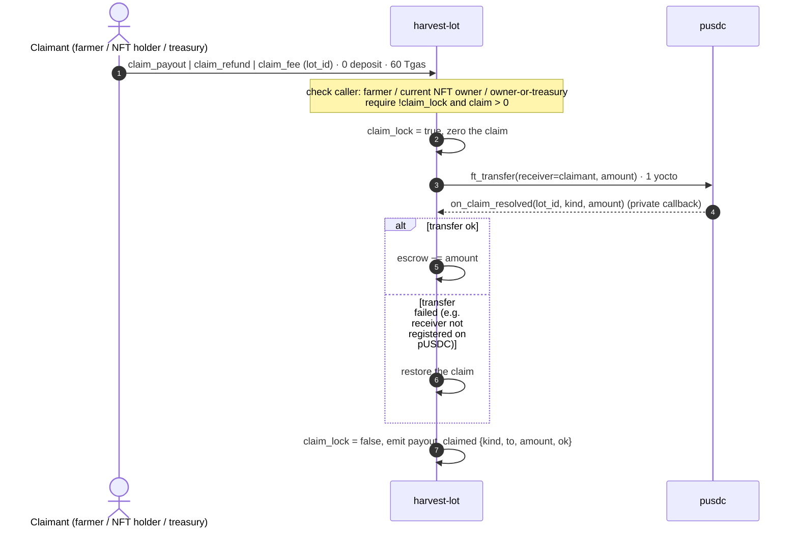

# Architecture

This page shows how Pratala's parts connect, how a harvest lot moves through its states, how money enters and leaves escrow, and who is trusted for what. Method names, arguments and events are defined in [`INTERFACES.md`](INTERFACES.md). Account ids come from `deploy/testnet.json`.

## 1. System

- The **frontend reads chain state directly over RPC** (lots, balances, claims). It uses the API only for off-chain data: evidence files, AI checks, history, payments ledger and CSV, notifications, profiles. If the API is down, every page still renders from chain data and shows an offline banner.
- **Wallets sign every on-chain action.** No server holds user keys. Verifier and farmer actions that attach no deposit can be signed with a function-call access key scoped to the lots contract, so they need no wallet popup after sign-in.
- **The backend never signs chain transactions.** It verifies NEP-413 signed messages for login. It indexes `EVENT_JSON:` logs from transactions reported to `POST /api/tx`, plus a periodic `get_lots` reconcile, into Postgres.
- **NEAR Intents 1Click** is mainnet-only and has no testnet. The checkout's "pay from any chain" tab requests `dry: true` quotes and labels them as quotes. No deposit address is used on testnet.

## 2. Lot lifecycle

Settlement at weigh-in: `delivered = min(actual_kg, projected_kg)`, `gross = delivered × price_per_kg`, `fee = gross × fee_bps / 10000`. The claims are `farmer = gross − fee`, `treasury = fee` and `holder = escrow − gross`. Reference lot (`lot-1` in the seed): 1,000 kg × 0.45 pUSDC = 450 escrow; 900 kg delivered at 200 bps → farmer 396.90, treasury 8.10, holder 45.00.

The lot stores claims and pays them only when someone claims them. The holder claim is paid to whoever owns the NFT **when `claim_refund` is called**. Transferring the NFT before that moves the refund right to the new owner.

## 3. Funding: `ft_transfer_call` → `ft_on_transfer`

The funding transaction can succeed on-chain even when `ft_on_transfer` rejected the payment, because the buyer gets a full refund. Clients and `scripts/04-seed-demo.sh` therefore confirm `status == "Funded"` and `holder == buyer` after the transaction, not only the transaction status.

## 4. Claims: claim → `ft_transfer` → callback

`nft_transfer` is rejected while `claim_lock` is set, so the NFT cannot change hands while a payout is in flight. It is also rejected on Cancelled lots.

## 5. Trust model

| Actor | Can | Cannot | Enforced by |
| --- | --- | --- | --- |
| Contract owner (root) | add/remove roles, set fee (≤ 1,000 bps), treasury, pause; cancel pre-listing lots; declare crop failure; claim fee | move escrow to itself beyond the fee claim; change a lot's price, weight or holder | `harvest-lot` owner checks |
| Field agent (`FieldAgent`) | attest a Registered lot (field visit, GPS hash, AI check hash) | also sign the co-op review of the same lot; settle; touch money | role allowlist |
| Co-op (`Coop`) | attest a FieldVerified lot (must differ from the field signer); declare failure on a Funded lot | weigh in; move funds | role allowlist + signer ≠ field signer |
| Warehouse (`Warehouse`) | weigh in a Funded lot (actual kg, grade, ticket hash) → Settled | change the price or the fee | role allowlist |
| Farmer | register, list, update price, delist, cancel own lots; claim payout | fund or settle own lot | `farmer_id == caller` |
| NFT holder (buyer or later owner) | transfer the NFT; claim the holder refund | claim while a payout is in flight | NEP-171 owner at claim time, `claim_lock` |
| pUSDC contract | the only account whose `ft_on_transfer` call is accepted | — | `predecessor == usdc_contract` |
| Backend | store evidence, run AI checks, index events, build CSV | sign or send any on-chain transaction | holds no keys |
| NEAR AI Cloud | return an advisory verdict with a signed response | approve a lot (humans attest; the AI hash is only recorded) | attestation is signed by the role holder |

The oracle is three allowlisted human attestations: field agent, co-op and warehouse. The AI evidence check is advisory. Its response hash goes on-chain so anyone can compare the stored JSON with the signature from NEAR AI Cloud. The allowlist is the main trust assumption, and it is listed as a limitation in the README.

## 6. On-chain vs off-chain

| Data | Where | Why |
| --- | --- | --- |
| Lot fields (crop, region, kg, month, price, status), attestations (signer, time, hashes, kg, grade) | `harvest-lot` state | source of truth for status and settlement |
| Escrow, claims, NFT ownership, roles, fee, treasury | `harvest-lot` state | money and control |
| pUSDC balances, storage registrations | `pusdc` state | NEP-141 |
| Events (`lot_*`, `payout_claimed`, `role_changed`, `nft_*`, `ft_*`) | transaction logs (NEP-297) | indexable history |
| Evidence photos, scale tickets | backend uploads; only the **sha256** is on-chain | size, privacy |
| Plot boundary and GPS | backend; only `plot_hash` / `gps_hash` on-chain | farmer location privacy |
| AI check request and response JSON, NEAR AI signature | Postgres; only `ai_check_hash` on-chain | verifiable without publishing images |
| Profiles, language, notifications, payments ledger, CSV export | Postgres (rebuilt from events) | convenience; chain remains authoritative |
| Farm-input listings and orders | Postgres; payment is a plain pUSDC `ft_transfer` with `memo="order:<id>"` | no escrow for inputs in this version |
| Cross-chain quotes | 1Click API (mainnet, dry), cached in Postgres | testnet has no Intents |
